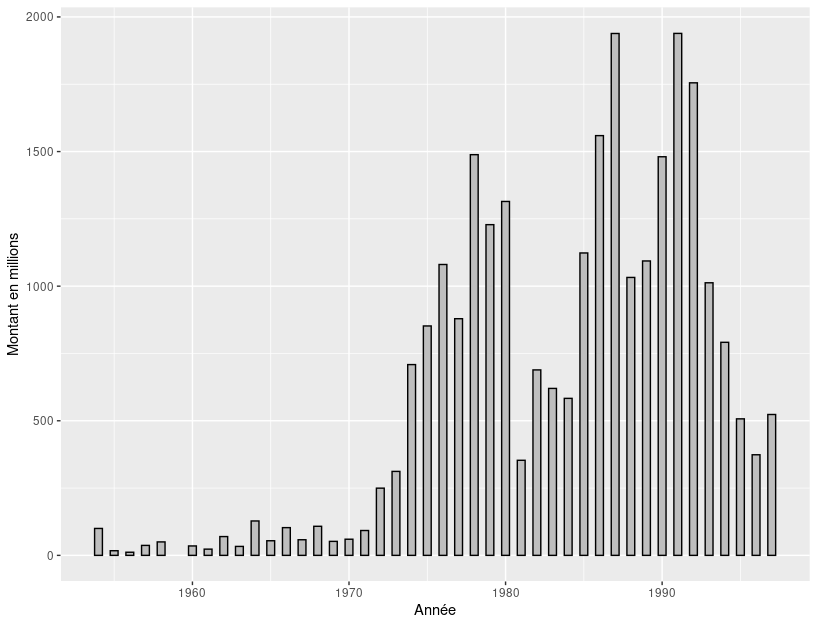

**Publications:** 

Tosolini, M., [‘Financing Industries on a Community Scale: the ECSC’s Borrowing Policy’](https://beta.u-strasbg.fr/WP/2024/2024-28.pdf), BETA Working Paper, 2024-28, 22p.

Tosolini, M., ['Financial sovereignty and monetary dependence', _Revue d'économie financière_,](https://shs.cairn.info/revue-d-economie-financiere-2026-3-page-199?lang=fr), 2026/3 n° 163 , 27p.

The European Coal and Steel Community was created in 1952 and disappeared in 2002. The High Authority, the executive power of the Community, was empowered to borrow money in order to grant loans to companies. Thus, debt was an ordinary instrument of the ECSC budget. The High Authority borrowed money between 1954 and 1997 up to $26 billion.

**Figure 1: Annual funds borrowed by the ECSC from 1954 to 1997 in current million US dollars**

Source: Author. To cite: Tosolini, M., ['Financial sovereignty and monetary dependence', _Revue d'économie financière_,](https://shs.cairn.info/revue-d-economie-financiere-2026-3-page-199?lang=fr), 2026/3 n° 163 , 27p.
